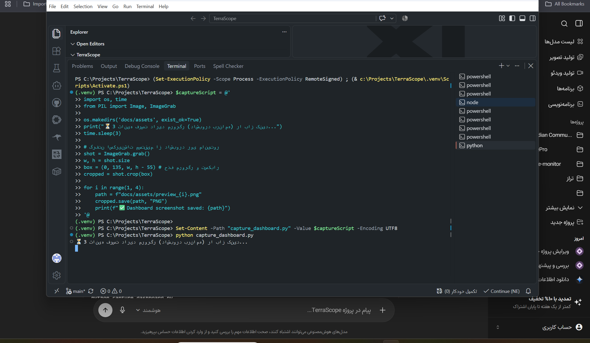

# 🌍 TerraScope: Open Satellite Environmental Intelligence Platform


**TerraScope** is a highly specialized, real-time Earth Observation (EO) and environmental intelligence platform designed to systematically monitor the ecological character of **Ramsar Wetlands**.

Developed with a core focus on **Ramsar Convention Article 3.2**, the platform utilizes automated ingestion of *Sentinel-2 STAC* data and integrates an advanced local Artificial Intelligence engine to detect, analyze, and report ecological shifts (such as water retreat, vegetative degradation, and dry bed expansion) over time.

---

## ✨ Core Features

*   🛰️ **Live Satellite EO Sync:** On-the-fly multi-spectral satellite data processing without the need for massive local storage.
*   🧠 **Time-Aware Ecological AI Engine:** Analyzes time-series indices (NDWI, NDVI) alongside official Ramsar Information Sheets (RIS).
*   📊 **Scientific Analytical Dashboard:** Real-time generation of ecological risk scores and dynamic parameter visualizations (Water vs. Vegetation vs. Dry Bed).
*   🌐 **Bilingual Interface:** Fully responsive UI/UX supporting both English and Persian (Farsi) for international and local researchers.
*   📑 **Automated Factsheet Generation:** Compliant with Ramsar COP standards for immediate policy-making distribution.

---

## 📸 Platform Previews

### Dashboard & Real-Time Monitoring


### Ecological AI Analysis & Risk Matrix


## 🚀 Quick Start (Local Deployment)

This repository contains the essential execution environment. Heavy geospatial `.shp` files and raw satellite archives are excluded to keep the repository lightweight.

### Prerequisites
*   Node.js (v20+)
*   Python (3.10+)

### Installation

1.  **Clone the repository**
```bash
git clone https://github.com/YOUR_USERNAME/TerraScope.git
cd TerraScope

Install Backend & Frontend Dependencies
bash
npm install

Run the Local Server
bash
node server.js

Navigate to http://localhost:3000 in your browser.
🔬 System Architecture
The Data Engine (Python): Automatically fetches and processes satellite metrics using on-the-fly EO cloud APIs.
Backend & Logic (Node.js/Express): Manages processing queues and serves strict JSON responses for the UI.
UI/UX (HTML5/CSS3/Vanilla JS + Leaflet): Renders interactive high-performance map instances with dynamic bounding boxes based on precise GeoJSON structures.
Developed for the preservation of critical global wetlands.
